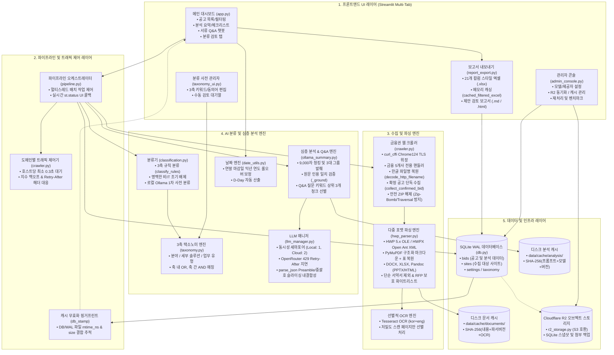
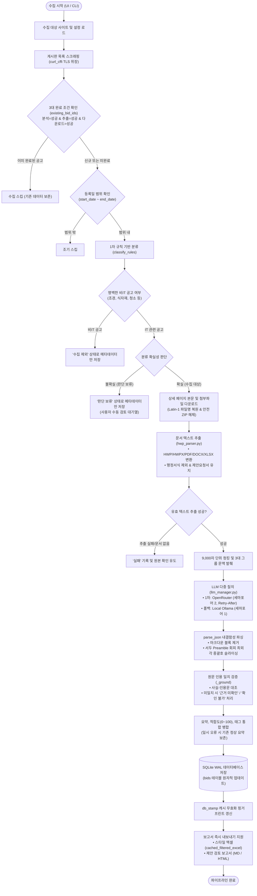
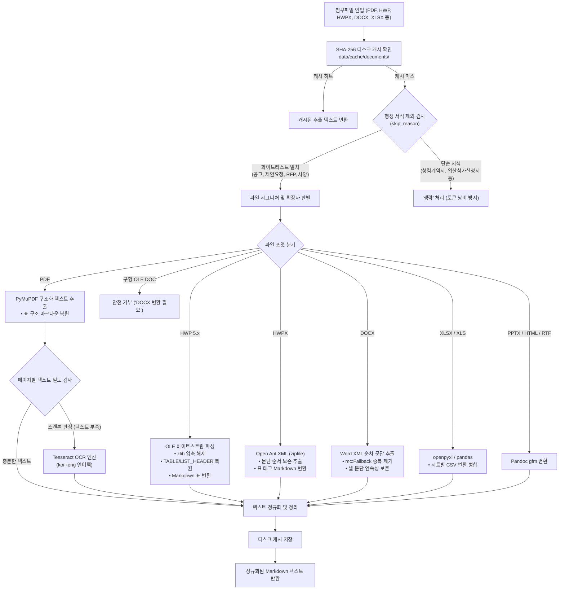
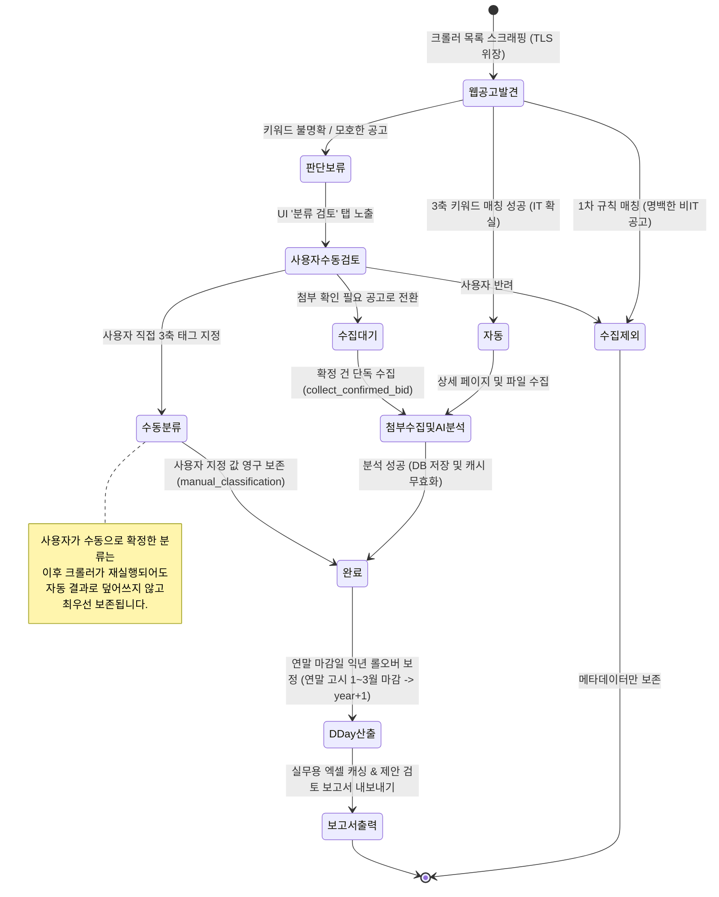
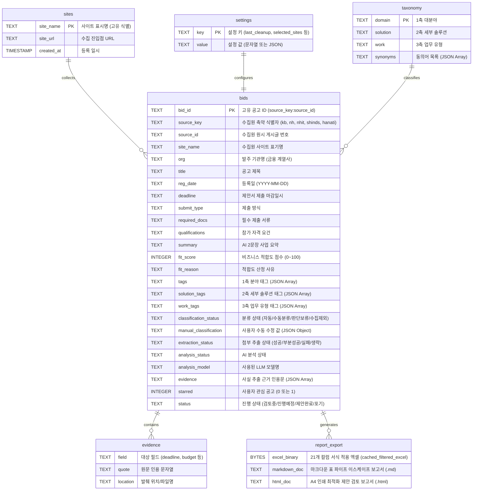

# BidInfo 시스템 구성 및 플로우 다이어그램 명세서

최신 업데이트: 2026-11-09
문서 목적: BidInfo(입찰정보 수집·분석 시스템)의 소스코드 및 명세서 최신화 내역을 반영하여, 5계층 아키텍처, 엔드투엔드 파이프라인, 지능형 파서 분기, LLM 사실 검증 및 Q&A 워크플로우, 상태 전이 머신, 데이터베이스 ERD 및 리포트 모델을 체계화하여 정의합니다.

---

## 1. 전체 시스템 구성도 (System Architecture & Component Map)

BidInfo 시스템은 프론트엔드 UI(Streamlit), 파이프라인 오케스트레이션 및 트래픽 제어, 수집 및 다중 포맷 파싱 엔진, AI 분류 및 듀얼 LLM 분석 엔진, SQLite/R2 스토리지 레이어로 구성된 5계층 아키텍처를 가집니다.

---

## 2. 수집 및 전처리 파이프라인 흐름도 (End-to-End Pipeline & Data Flow)

웹 목록 스크래핑부터 3대 조건 중복 판별, 조기 필터링, 상세/첨부 수집, 텍스트 파싱, LLM 심층 분석, 사실 검증 및 WAL 적재와 보고서 내보내기까지의 실행 순서입니다.

---

## 3. 지능형 문서 파싱 및 OCR 분기 구조도 (Document Parser Engine)

다양한 공공/금융 첨부파일 포맷을 안전하게 텍스트 및 Markdown 표로 복원하고, 행정 서식을 조기에 필터링하는 파서의 분기 흐름입니다.

---

## 4. LLM 심층 분석 및 사실 인용 검증 / Q&A 워크플로우

환각(Hallucination)을 원천 차단하기 위해 9,000자 청크 분할, 3대 정보 그룹 발췌 질의, 원문 인용 검증(`_ground`) 및 대용량 문서 Q&A 질문 키워드 선별 질의를 수행하는 워크플로우입니다.

```mermaid
flowchart TD
    subgraph Analysis_Flow ["1. RFP 심층 분석 워크플로우"]
        RawText["추출된 RFP 전문 텍스트"] --> Chunking["9,000자 단위 청킹 (document_chunks)"]
        RawText --> GroupPassages["3대 정보 그룹 발췌 (_passages)<br/>• 그룹 1: 마감일, 제출방식<br/>• 그룹 2: 필수서류, 참가자격<br/>• 그룹 3: 예산, 사업기간, 평가배점"]
        
        GroupPassages --> LLMCall["LLM 디스패처<br/>• OpenRouter (세마포어 2, Retry-After)<br/>• Local Ollama (세마포어 1)"]
        LLMCall --> ParseRobust["parse_json 내결함성 디코딩<br/>• Markdown 코드블록 제거<br/>• 서두 Preamble 회피 최외각 중괄호 슬라이싱"]
        
        ParseRobust --> QuoteMatch{"원문 인용 대조 (_ground)<br/>(quote in raw_text)"}
        QuoteMatch -- "원문 일치" --> FormatCheck{"형식 유효성 정규식 검사<br/>• 마감일/기간: 날짜/숫자 포함<br/>• 예산: 금액 단위(원/억) 포함"}
        QuoteMatch -- "원문 불일치 (환각)" --> RejectFact["사실 기각 ('확인 불가' 처리)"]
        
        FormatCheck -- "형식 유효" --> AcceptFact["유효 사실 확정 및 Evidence 기록"]
        FormatCheck -- "모호한 서술" --> RejectFact
        
        AcceptFact --> MergeResults["청크별 요약 병합 & 중복 근거 제거"]
        MergeResults --> ScoreCalc["비즈니스 적합도 산출 (0~100점)"]
    end

    subgraph QA_Flow ["2. 대용량 문서 서류 Q&A 챗봇 워크플로우 (answer_bid_question)"]
        UserQ["사용자 질문 인입"] --> ExtractQWords["질문 내 의미 키워드 추출 (길이 ≥ 2)"]
        ExtractQWords --> RankChunks["청크별 키워드 빈도 채점 및 랭킹"]
        RankChunks --> PickTop3["상위 최대 3개 청크만 선별<br/>(토큰 낭비 및 지연 방지)"]
        
        PickTop3 --> QACall["선별 청크별 LLM 질의 (JSON 모드)"]
        QACall --> VerifyQAQuote{"청크 내 원문 인용 대조"}
        VerifyQAQuote -- "인용 일치" --> FormatQA["답변 및 원문 근거 매핑 반환"]
        VerifyQAQuote -- "인용 불일치" --> DropQA["답변 제외"]
    end
```

---

## 5. 3축 택소노미 및 분류 상태 전이 머신 (State Machine)

공고가 수집되어 분류 확정, 사용자 수동 수정 및 연도 롤오버 D-Day 계산에 이르는 라이프사이클 상태 머신입니다.

---

## 6. 데이터베이스 ERD 및 스토리지/리포트 모델 (ERD & Storage)

SQLite WAL 데이터베이스의 주요 테이블 구조, 인덱스, 3대 완료 판정 조건, 디스크 캐시 및 실무용 리포트 내보내기 연동 관계도입니다.

